# NetSim

NetSim is a network simulator that runs entirely in your browser. You build an IPv4
network on a canvas, start the clock, and watch the real protocols run one packet at
a time. Every frame that crosses a link can be opened and read down to the byte, the
way you would in Wireshark, except here you also control the network that produced it.

I built it because the hard parts of networking are the parts you cannot see in a
textbook: the timing, the state that each device keeps, and what happens when things
go wrong. A diagram of the TCP handshake does not show you slow start backing off
after a loss, and a static capture does not let you pause, change one setting, and run
it again. NetSim does. There is nothing to install and no server to run. The whole
simulation happens on your machine, in simulated time that you drive.

Live at https://netsim.jyotiprakash.org

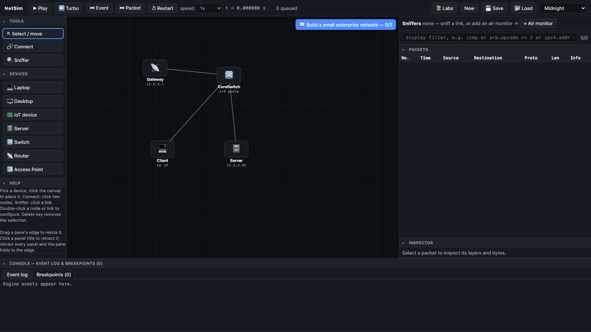

## What you can do with it

Drag devices from the palette onto the canvas, wire them together, give them
addresses, and run commands from a terminal on any host. Attach a sniffer to a link
and read the traffic. Turn on a routing protocol and watch it converge. Break a link
and see the network heal, or fail to. The clock is yours: play it at a chosen speed,
run it flat out until it goes quiet, step forward one event or one packet at a time, or
set a breakpoint that stops the moment a packet matches a condition you write.

Because the simulation is paused by default, a command like `ping` schedules its work
and then waits for you to advance time. The top bar and the terminal both tell you when
that is the case, so nothing looks stuck.

On any host you can also open a Code tab and write real C socket programs that compile in
the browser and run on the simulated network, with everything from `socket` and `connect`
up through processes, threads, and `select`, `poll`, and `epoll`. It is a feature in its
own right, with its own section further down.

## A short tour

Every host has a small virtual operating system with a terminal. Here a laptop pings
another host and reads back the round trip times. The first reply is slower because an
ARP exchange has to resolve the destination hardware address before the first packet
can leave.

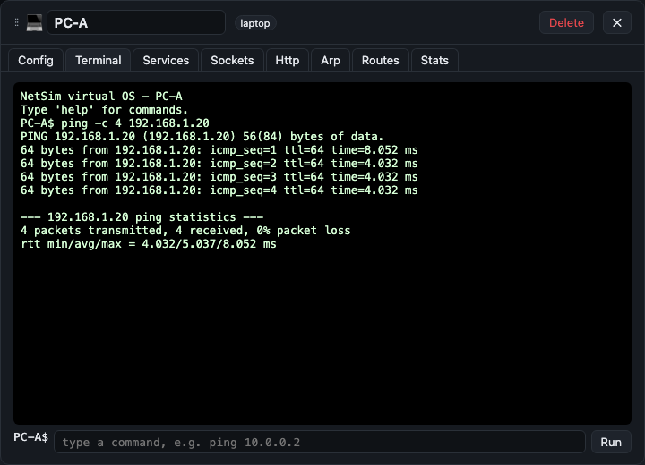

The configuration popup for a host lets you set interface addresses, the default
gateway, DNS servers, and the TCP settings that apply to new connections, including the
congestion control algorithm.

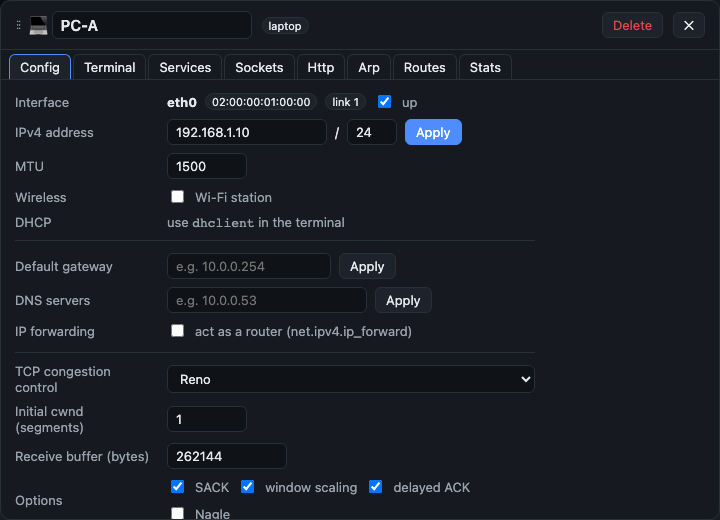

Attach a sniffer to any link and it records every frame that crosses it, with a display
filter grammar shared across the tool.

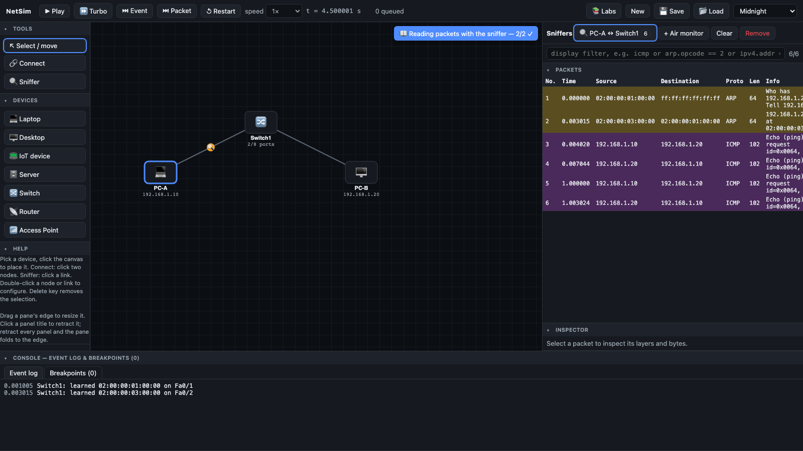

Click a frame to decode it. The layers are nested the way they are on the wire, from
Ethernet up through IPv4 and ICMP, and hovering a field highlights the exact bytes it
occupies in the hex dump.

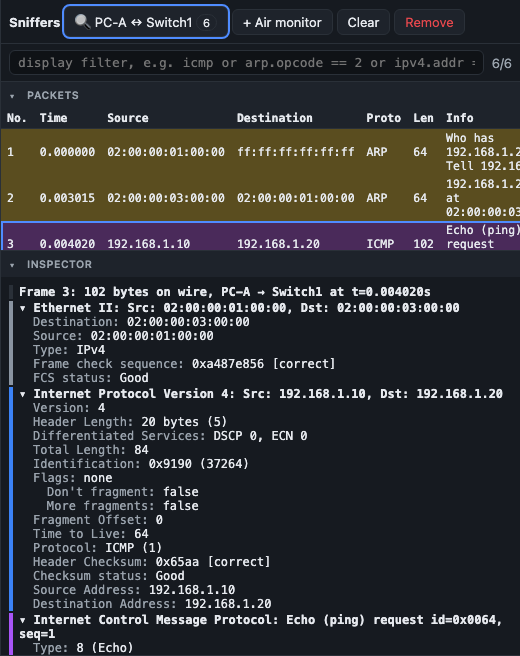

You can go one level lower and look at the physical encoding of the bits, with line
codes such as NRZ, NRZI, and Manchester.

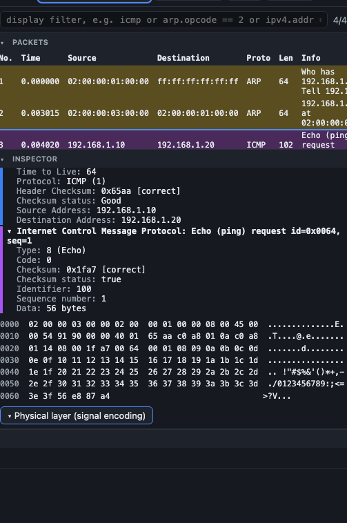

Set a breakpoint on a condition and the simulation stops the instant a matching packet
appears, so you can inspect the network at that exact moment.

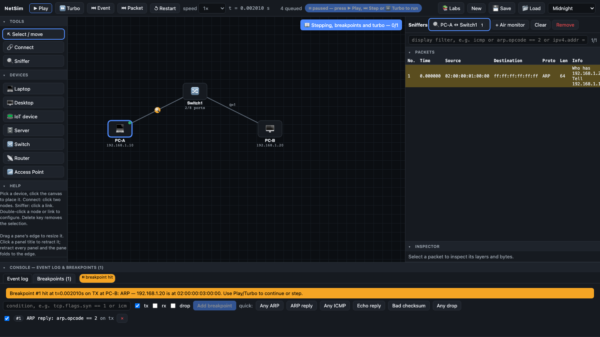

The event log records what the engine did and when, in simulated time.

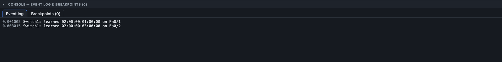

## Routing

OSPF forms adjacencies from its hello exchange, builds a link state database, runs
shortest path first, and installs routes. The panel shows neighbors, the database, and
per interface costs you can change.

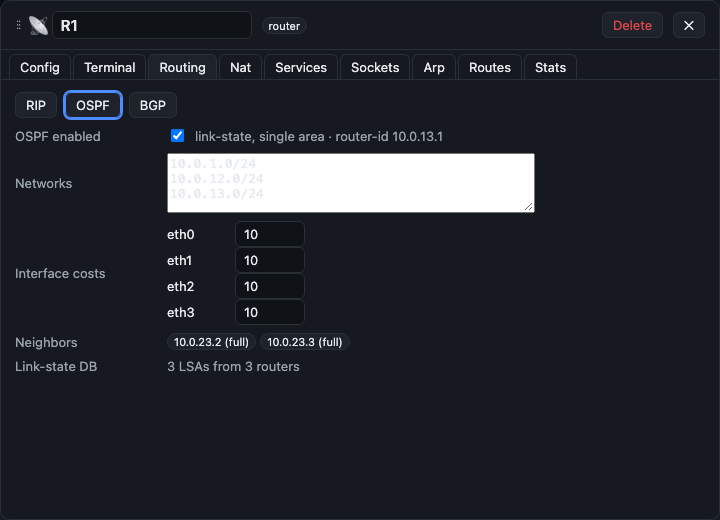

You can also work with plain static routes and add your own.

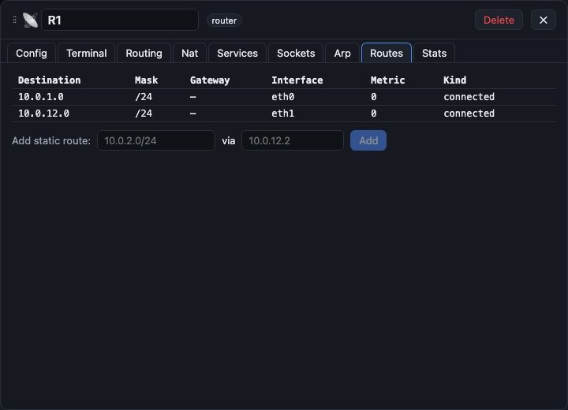

BGP runs eBGP and iBGP, including route reflectors, and shows the path it chose.

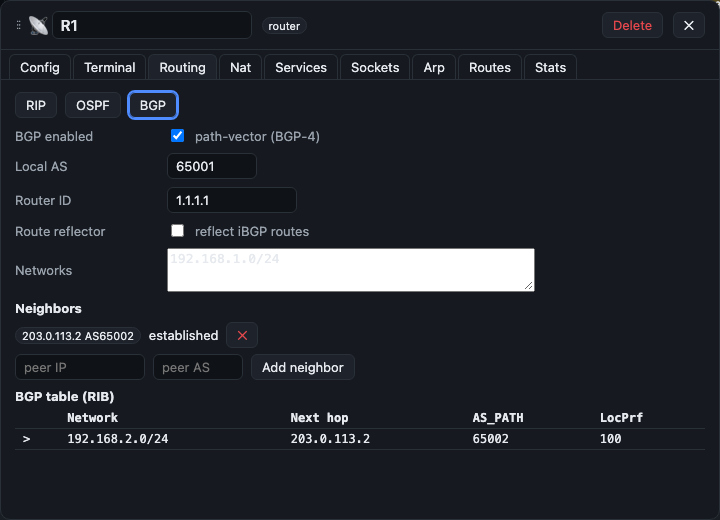

NAT does source translation and port forwarding, and keeps a live translation table.

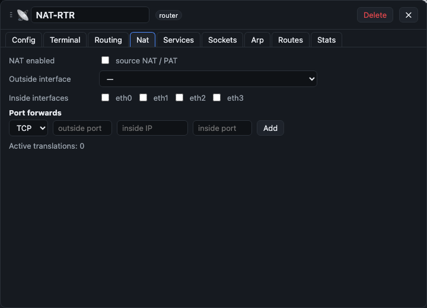

## Addresses, names, and the web

A DHCP server hands out addresses, gateways, and DNS servers through the four message
Discover, Offer, Request, Acknowledge exchange. The client terminal shows the lease it
received.

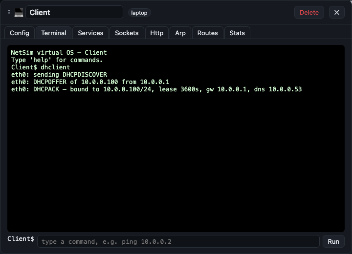

DNS is a real hierarchy with authoritative zones and a recursive resolver, so you can
watch a name get resolved step by step.

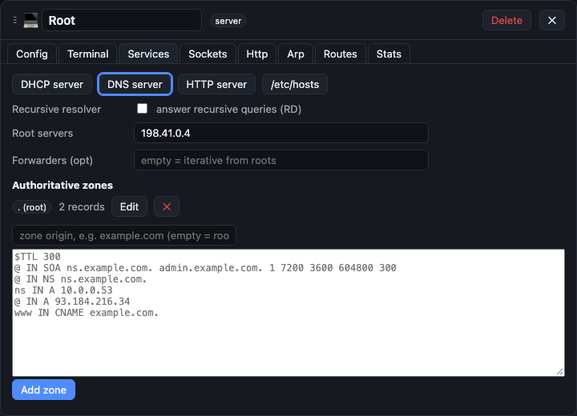

HTTP rides on TCP, and the client keeps a waterfall of each request so you can see the
handshake, the request, and the response in order.

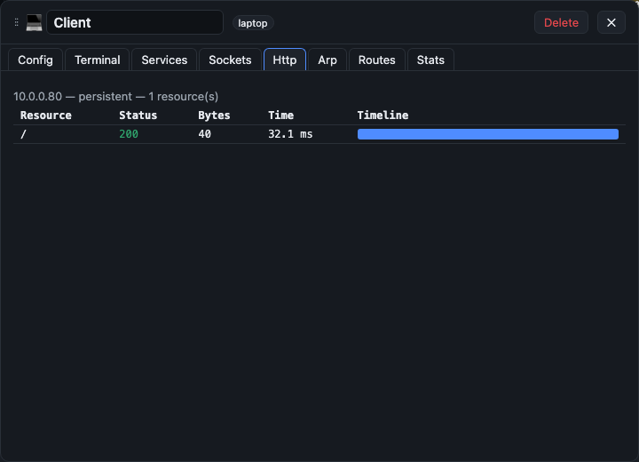

## Switching

Switches learn MAC addresses and support 802.1Q VLANs with access and trunk ports.

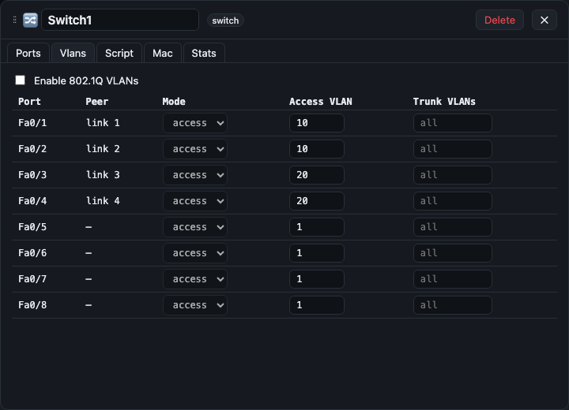

If you want to change how a switch forwards, you can replace its learning logic with
your own JavaScript. The program runs sandboxed in the worker with a small, frozen API
and no access to the network, the page, or the file system.

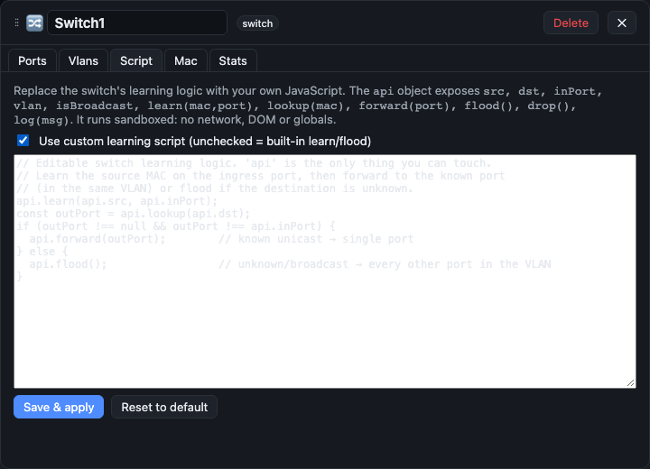

## Wireless

Wireless is a shared medium model in the style of 802.11. Stations sense the carrier,
back off, and collide; you can turn on RTS and CTS to reserve the medium, reproduce the
hidden node problem, and watch a station associate with an access point. An air monitor
captures frames off the air the same way the wired sniffer captures them off a link.

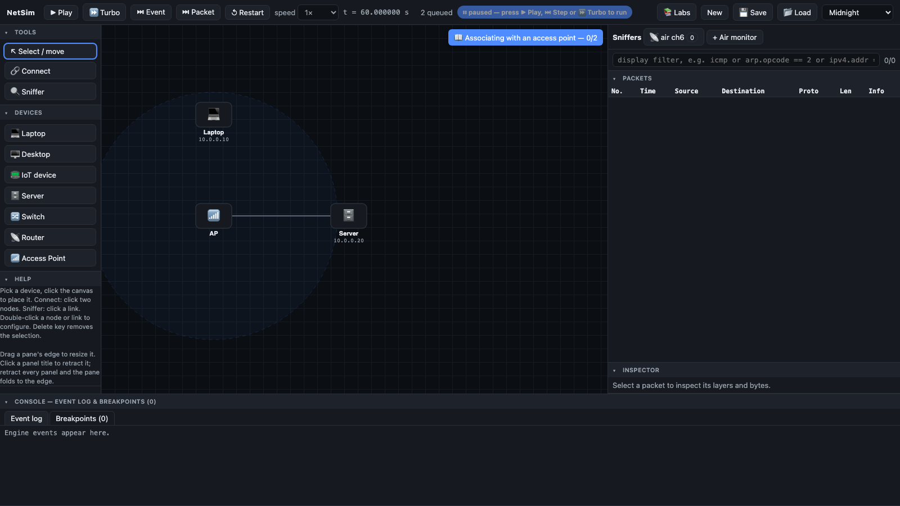

## Transport

TCP is implemented with Tahoe, Reno, NewReno, and CUBIC congestion control, selective
acknowledgements, flow control, and retransmission timeout backoff. The sockets panel
charts the congestion window and the sequence space over time so the behavior is visible
rather than described.

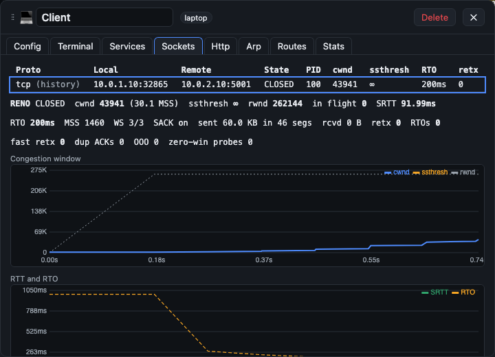

## Writing C socket programs

NetSim has a C workspace. Open the Code tab on any host and you can write a real C program
against the Berkeley sockets API, compile it in the browser, and run it on the simulated
network. There is no server and nothing to install: the compiler runs in the same worker as
the simulation, and the program's sockets are wired to the simulated TCP and UDP stacks, so
the bytes it sends appear in the sniffer like any other traffic. Every run is sandboxed. The
program cannot touch a real socket, a real port, the page, or the file system; a system call
only moves data inside the simulation.

Two compilers sit behind the same Compile and Run button. The default is a real build of
clang with a C standard library, so you get the whole language: structs, pointers, `malloc`,
`printf`, `string.h`, and the system calls that matter for networking. That includes `fork`
and `exec` for multi process servers, `signal`, `alarm`, and `kill` with real handlers and
`EINTR` on an interrupted call, POSIX threads through `#include <pthread.h>` for a thread per
connection, and `select`, `poll`, and `epoll` for one thread that serves many clients at
once. The clang toolchain is about sixty megabytes and is fetched once, behind an explicit
button, then cached; it is the only part of NetSim that is not already on the page. For quick
experiments there is also a small C subset that compiles instantly with no download.

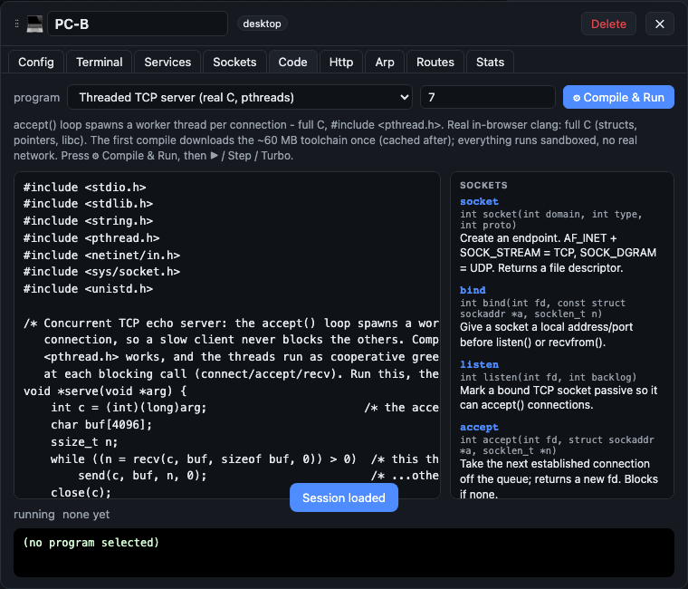

A program is a process on the host, driven by the same clock as everything else, and
blocking calls really block. A `connect` waits for the handshake, an `accept` waits for a
client, a `recv` waits for data: the program suspends until the simulated network makes
progress and then resumes exactly where it left off, so you can step one system call at a
time and watch it happen. The inspector shows the program's open file descriptors mapped to
live socket state and what it is currently blocked on, so a server sitting in `select` with a
listening socket looks like what it is.

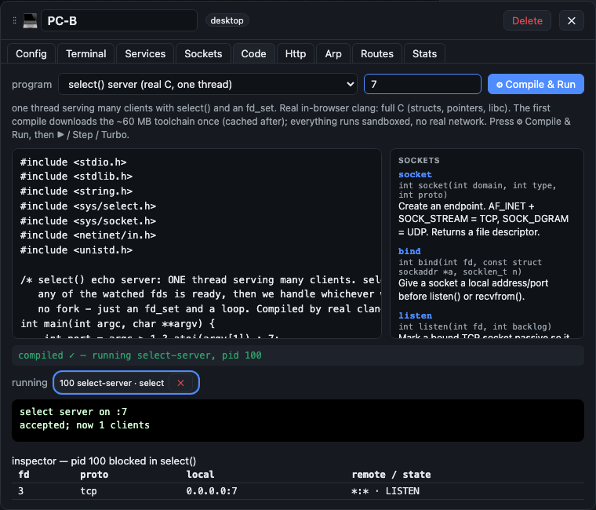

There is a module of guided labs for all of this, from a first UDP datagram and the TCP
handshake up to a thread per connection server, the same server written three ways with
select, poll, and epoll, and a lab on signals and `EINTR`. The feature is introduced in the
welcome tour, and the editor keeps the full API reference beside it so you are not writing
from memory.

## The guided labs

There are eighty-one guided labs across nineteen modules, from a first ping up to full
troubleshooting and enterprise capstones. Each lab gives you the background, then a set
of numbered steps with the exact values to enter, things to observe, prompts to write
your own notes, checks that tick off automatically as you get them right, and a few
questions to test your understanding. There is a notes field saved per lab in your
browser.

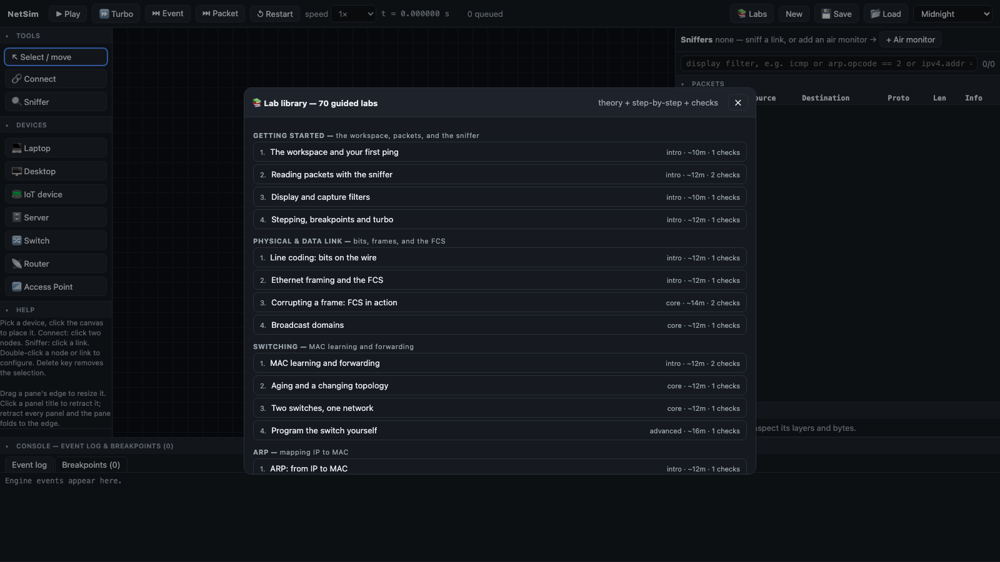

The guide floats over the canvas so you can read a step and act on it at the same time.
You can move it, resize it, or fold it away.

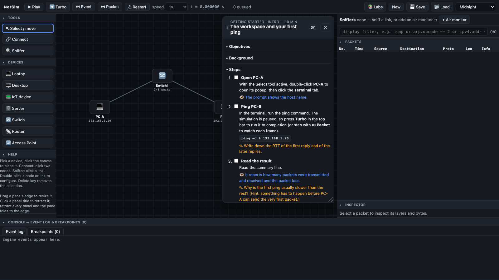

The modules are: getting started, physical and data link, switching, ARP, VLANs, IPv4
and subnetting, fragmentation and ICMP, static routing, RIP, OSPF, BGP, NAT, transport
with UDP and TCP, DHCP and DNS, HTTP, wireless, security, capstones, and socket
programming in C.

## Using it for research

The same two properties that make NetSim a teaching tool, a run that is deterministic to
the byte for a given seed and a stack whose packets are byte accurate, also make it a
usable research instrument. A small set of capabilities builds on the engine without
changing its default behavior:

- **Reproducibility capsules** (`src/session/capsule.ts`) record a run as a setup, an
  ordered list of commands and clock advances, and a SHA-256 hash over the whole engine
  state. Replaying a capsule on a fresh engine reaches a byte-identical state, which the
  tool verifies against the stored hash, so a result can be shared as a small object that
  re-executes rather than a description.
- **Labeled capture export** (`src/engine/export/pcap.ts`) writes any sniffed link to a
  standard `libpcap` file that Wireshark, tshark, and Scapy read directly, with an
  optional ground-truth label sidecar: the engine tags each frame it transmits, so the
  labels are emitted, not inferred.
- **A controlled-scheduler oracle** (`src/engine/cc/scheduler.ts`) exposes the one
  scheduling choice in the C runtime, which runnable thread advances next, so an external
  driver can explore and replay thread interleavings while packet events stay on the same
  clock. With no oracle installed the runtime behaves exactly as before.
- **A metrics library** (`src/engine/metrics.ts`) computes throughput, Jain fairness,
  loss, round-trip time, and queue occupancy from engine state and captures.
- **An interaction-trace recorder** (`src/ui/trace.ts`) logs learner actions for
  education research, off by default and anonymized.
- **A shared command path** (`src/engine/commands.ts`) applies a command to the engine
  the same way in the browser worker, in a capsule replay, and in a headless sweep, so an
  experiment driven in Node reproduces what the interface does.

Everything here runs in the browser or in a headless Node process, in process, over
loopback only, opening no real socket and transmitting no real packet.

## A note on appearance

There are forty color themes, twenty dark and twenty light. Here is a light one.

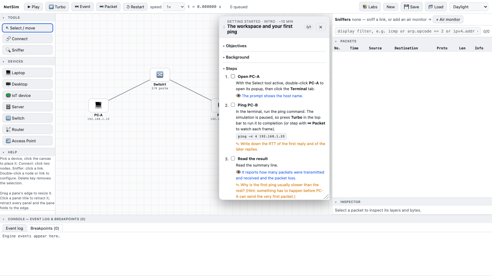

## Running it locally

You need Node 20 or newer.

```
npm install
npm run dev
```

The development server binds to 127.0.0.1 only and prints a local address. To build the
static site and preview the production build:

```
npm run build
npm run preview
```

The preview server also binds to loopback only. The build output in `dist` is a plain
static site that can be served from anywhere; there is no backend.

## How it is built

The application is Vite, React, and TypeScript, with Zustand holding the small amount of
UI state. All of the simulation lives in a single Web Worker.

The engine is a discrete event simulator. It keeps its own clock in integer
microseconds and advances by pulling events off a heap, so there is no wall clock inside
the simulation and a run is deterministic for a given seed. Every piece of engine state
is plain serializable data, which is what makes save and load, stepping, and snapshots
to the UI possible. Timers are just events scheduled for a future time.

The codecs read and write real packet bytes. The same encoder that puts a TCP segment on
the wire is the format the decoder and the sniffer read back, so there is one source of
truth for what a packet looks like. The UI never reaches into the engine. It sends
command messages to the worker and renders the state snapshots the worker posts back.

## Testing

The project is tested without any manual clicking. Unit tests under `tests/unit` cover
the codecs, the engine, each protocol, the in-browser C compiler and its socket runtime,
and a check that every one of the eighty-one labs is actually completable. End to end tests under `tests/e2e` drive the real interface in a
headless browser. The full gate is:

```
npm run verify
```

which runs the type checker, the unit tests, a production build, and the end to end
tests. Every server it starts binds to loopback only, and nothing in the app makes a
real network request.

## Project layout

```
src/engine      the simulation: core loop, codecs, devices, protocol stacks, worker
src/filters     the display and capture filter grammar
src/session     save and load
src/shared      byte helpers, checksums, the worker protocol
src/ui          canvas, panels, popups, themes, and the guided labs
tests           unit tests and headless end to end tests
```

## Limitations

This is a teaching tool, not a production simulator. It is IPv4 only. It is comfortable
up to roughly fifty nodes. Some timings are simplified so that behavior is visible on a
human timescale rather than faithful to the microsecond. It will not replace a real
capture on real hardware, and it is not meant to.

## License

NetSim is free software under the GNU General Public License, version 3 or later. See
`LICENSE` for the full text and `COPYRIGHT` for the notice.
